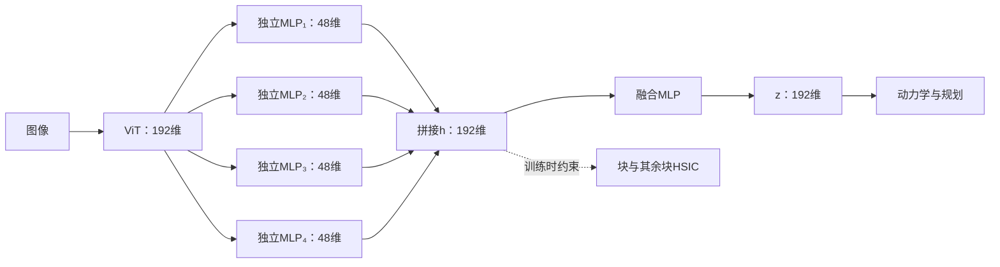

# 减少 JEPA 表征中的重复信息

## 动机

想法来自 Hugues Van Assel 的[博客](https://huguesva.github.io/blog/2026/world-models/)。其中的 JEPA 分析指出，在简化设定下，模型偏好容易预测的因素；PushT 实验也显示，一个稳定但与任务无关的色块，就可能严重影响规划。

[When Does LeJEPA Learn a World Model?](https://arxiv.org/html/2605.26379v1) 进一步分析了同一因素的高次项：在特定高斯、各因素时间相关性相同的设定下，高阶项受到更强惩罚，最优表示偏向线性项。它没有证明实际模型不会重复编码同一因素。

由此提出一个假设：**实际因素的变化速度不同，一个稳定因素的多种函数，仍可能反复占据表征维度。能否减少这些重复，让其他因素更容易保留下来？** 这是我们的推断，不是上述论文已证明的结论。

## 已有方法与问题

保留 LeWM 的预测损失和 SIGReg，将共享 MLP 输出的192维表示分成四个48维块。每块与其余三块的拼接表示计算 HSIC，鼓励减少依赖：

$$
L=L_{\mathrm{pred}}+0.09S(z)+\lambda D(z).
$$

这里 S 是 SIGReg，帮助防止表示坍缩；D 是四项“块与其余块 HSIC”的平均，仅用于训练。HSIC 不增加模型参数。

**问题在于：HSIC 也可能导致有用信息丢失。** 不同物理因素可能相关，降低依赖既可能减少重复，也可能压掉彼此互补的信息。因此，HSIC 下降不等于表示变好，独立也不等于每块各自对应一种语义。

合成实验中，非线性探针显示弱因素读出有所改善，但完整 PushT 规划并未稳定改善。同预算、每模型100集的结果如下：

| 背景 | λ0 | λ200 |
|---|---:|---:|
| 稳定色块 | 4% | 9% |
| 灰背景 | 82% | 19% |
| 逐帧随机色块 | 67% | 10% |

其他条件的读出与规划退化，和“有用信息被压掉”的解释相符，但尚不能确定原因。视觉实验只有一个训练种子。表中均为27,866步；下载的32,866步模型另见[模型卡](model-card.md)。

## 新方案：四个头提取，再融合

将“降低依赖”和“用于预测规划”的表示分开：四个独立 MLP 都读取同一个完整的192维特征，各输出48维，再拼接、融合为192维 z。

HSIC 约束融合前的 h，预测与规划使用融合后的 z。希望融合层能组合四路信息，缓解独立性约束与任务需求之间的冲突。

另一个版本将 SIGReg 前后各分一半，抑制某些头退化：

$$
L=L_{\mathrm{pred}}(z)+0.09\left[(1-\alpha)S(z)
+\frac{\alpha}{4}\sum_{i=1}^{4}S(h_i)\right]+\lambda D(h).
$$

α=0 时，SIGReg 全放在 z；α=0.5 时，z 权重0.045，每个头权重0.01125。头上有变化，不保证变化有用，也不保证四路自然形成语义分工。

| 对照 | 结构 | SIGReg位置 |
|---|---|---|
| A | 共享MLP后分块，直接使用 | 最终表示 |
| B | 四个独立头，拼接后直接使用 | 最终表示 |
| C | 四个独立头＋融合MLP | 融合后 |
| D | 四个独立头＋融合MLP | 融合前后各半 |

每种结构都需 λ0 对照，区分结构与 HSIC 的影响。**四头融合方案尚未验证，本仓库目前实现的是直接分块 HSIC。** 新结构也不能保证恢复已丢失的信息。下一步应同时看各头及最终表示的线性、非线性读出，以及预测和规划表现，而不是只看 HSIC。
