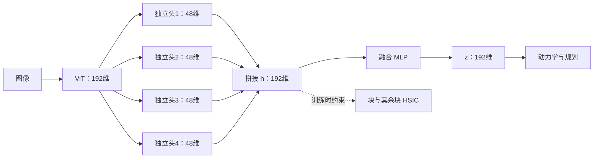

# 从可预测性偏置到分块去冗余：JEPA 表征的探索

> 研究记录，2026-10-19。本文区分动机来源、已完成实验与待验证方法。已完成的视觉实验使用共享投影后的直接分块 HSIC；四头与融合结构尚未完成实验，也未完成视觉 PushT 验证。

## 1. 动机：容易预测，不一定对规划有用

这个想法直接受到 Hugues Van Assel 博客 [Feature Selection in World Models: A Spectral View](https://huguesva.github.io/blog/2026/world-models/) 中 **JEPA 分析与稳定色块实验**的启发。

博客将不同世界模型放进共享模态的线性高斯系统中比较。在其编码器限制与简化正则下，JEPA 对模态的排序取决于可预测比例，而非观测方差。可预测性可以来自时间上的持续，也可以来自动作影响；目标本身不区分这些来源。这个结论有明确假设，不能直接当作任意非线性 JEPA 的定理。博客用协方差正则近似分析，实际 SIGReg 还约束投影分布的高阶性质。

博客随后给出 PushT 压力测试：在不遮挡任务画面的角落放一个色块，比较灰色、每个 episode 内稳定、逐帧随机三种条件。稳定但无关的色块会严重损害规划；改变它的时间可预测性后表现恢复。这个实验与原始代码属于博客作者，我们沿用其干预方式进行后续研究。

由此产生的问题是：**如果一个容易预测的因素能通过多种变换反复进入表示，有限的表征容量是否会被它占用，导致其他因素不容易保留下来？** 我们希望减少跨块的统计重复，为不同内容提供表达空间。这是进一步提出的假设，博客没有证明“冗余就是规划失败的原因”，也没有证明去冗余一定有效。

这里说的强因素，是在当前数据与目标下容易占据表示的因素，不单指像素幅度大；弱因素是相对难以保留或读出的因素。二者都不等同于任务重要性。

## 2. 为什么先考虑分块

将一个192维向量分为四个48维块，能够明确询问：各块是否反复携带相近的信息？但仅有结构划分没有约束作用。正交投影也不够，例如从 `[c,c]` 中分别取两个坐标，方向正交，内容仍重复。零协方差同样不能排除非线性依赖。

SIGReg 应继续保留。它推动投影分布接近标准高斯，帮助防止坍缩；有限 batch、有限投影与非零优化误差，不等于严格实现联合标准高斯。另一方面，严格的联合标准高斯确实具有独立坐标，不应否认这一数学性质。

即使实现统计独立，也不能自动获得语义分工。例如独立标准高斯变量 a、b 经正交混合后仍独立，却都混合了原始因素。因此，我们首先探索的是**降低跨块可检测的依赖**，不预先规定某块表示颜色、位置或朝向。

早期也讨论过通过前缀预测残差寻找增量信息，但残差容易混入预测器欠拟合与尺度变化。后续选择先检验更简单的 HSIC 约束，减少同时引入的机制。

## 3. 第一版方法：预测＋SIGReg＋块间 HSIC

当前已运行的视觉结构为：

```text
图像 → ViT-Tiny → x∈R¹⁹²
                   ↓
          共享投影 MLP：192→2048→192
                   ↓
             z=[z₁,z₂,z₃,z₄]
                   ↓
          动作条件动力学预测与规划
```

当前每个输出块已经通过共享 MLP 看到了完整 x，并非先把 ViT 特征切开再分别处理。

对 batch 中同一时间位置的表示，令 `z_{−i}` 为除第 i 块外的其余块拼接。去依赖项为

$$
L_{\mathrm{dep}}=\frac{1}{4T}\sum_{t=1}^{T}\sum_{i=1}^{4}
\widehat{\mathrm{HSIC}}(z_i^{(t)},z_{-i}^{(t)}).
$$

采用 block-versus-rest，而非只比较块对，是为了也检查某块与其他块联合内容的依赖。使用中心化 RBF 核的有偏经验估计：

$$
\widehat{\mathrm{HSIC}}(U,V)
=\frac{\langle HK_UH,HK_VH\rangle_F}{(B-1)^2},
\quad H=I-\frac{\mathbf1\mathbf1^\top}{B}.
$$

核为 `exp(−||u−v||²/(2σ²))`，σ² 取 batch 内正的非对角平方距离中位数，并设置数值下限。不同时间分别计算，不能把时间帧误当作独立 batch 样本。

完整目标为

$$
L=L_{\mathrm{pred}}+0.09L_{\mathrm{SIGReg}}+\lambda L_{\mathrm{dep}}.
$$

预测器读取历史表示和动作，预测移位后的未来表示；保持原目标两侧的梯度路径。HSIC 无可训练参数，仅用于训练。推理仍使用原动力学、潜空间距离与 CEM，不调用 HSIC，也不使用状态标签。

## 4. 带宽求导：一次必要的实现修正

最初使用逐批重算但截断梯度的中位数带宽。数值上，若所有特征同时缩放，距离与带宽会同比缩放，前向 HSIC 近似不变；但反向若把带宽固定，就不再是这个重算目标的完整导数，可能产生额外的尺度收缩分量。

合成实验在较大 λ 下出现严重尺度坍缩。固定端点的梯度检查支持上述解释。移除带宽的梯度截断后，径向梯度接近零；在相同400步预算下，总方差恢复到约191–198，严重尺度收缩得到缓解。这是实现修复，不意味着依赖损失与预测目标已经协调。

中位数本身还有局限：其导数只经过选中的距离，可能让少数样本承受较多梯度。可微带宽解决了缩放方向的不一致，却没有解决所有梯度分配问题。

## 5. 实验反馈：需要同时看读出和规划

### 合成机制实验

输入包含一个强因素的傅里叶展开、三个弱因素和噪声，以小型 MLP 进行400步训练，三个配对种子。这个设计刻意提供强因素的多种函数，是机制压力测试，不是图像或规划基准。

起初只看线性探针，未观察到弱因素改善。加入冻结编码器的非线性探针后，结论改变：基线弱因素 MLP 测试 R² 约0.085，可微带宽 HSIC 的 λ200–1000 约0.760–0.878；强因素高阶读出仍约0.999。随机初始化弱因素非线性读出约0.984，也说明训练后的可读性不能仅与低分基线比较。

因此，“线性读不出来”不能推出“信息不存在”；读出改善也不能单独证明因素独立或语义分离。三个训练种子与探针拟合种子必须分别统计。

### 完整视觉 PushT

使用192维、四块、seed4711、batch128、BF16、两轮共27,866次更新。以下是 λ200 campaign 中每模型100集的配对评估：

| 背景 | λ0 | λ200 | 差值 |
|---|---:|---:|---:|
| 稳定色块 | 4% | 9% | +5个百分点 |
| 灰背景 | 82% | 19% | −63个百分点 |
| 逐帧随机色块 | 67% | 10% | −57个百分点 |

稳定色块略升，但总体不能解释为方法有效；其他条件明显退化。λ600 也未解决问题，对应成功率为7%、5%、8%，其匹配 λ0 新评估分别为3%、81%、65%。不同 campaign 的规划重跑存在少量波动，不能混用参照列。

冻结表征的物理状态非线性 R²，在灰背景上由 λ0 的约0.969降至 λ200 的0.842、λ600 的0.715。它与规划退化方向一致，但探针不是原规划器，两者不能直接等同。

### 梯度与继续训练

在49次冻结诊断中分别测量各损失的实际参数梯度。λ200 时，HSIC 加权梯度相对预测梯度在共享表征参数上的中位范数比，稳定、灰色、随机条件约为12.8、3.45、4.43。它们并非统一反向对抗，许多方向接近正交。

HSIC 还会通过全局裁剪影响其他模块：动力学参数虽不直接接收 HSIC 梯度，仍可能因为总梯度过大而被一起缩小。可微中位数带宽下，部分灰背景端点的单时间、单块 latent 梯度集中在少数样本；FP32 检查仍复现。总方差正常时，有效秩也可能显著下降。

这些是端点诊断，不能据此证明完整的训练因果链；原始梯度与裁剪比例也不是 AdamW 最终参数更新比例。

随后备份 λ200 三模型，各继续训练5000步到32,866步。模型与 AdamW moments 保留，但原学习率已归零，因此重启了50步预热与余弦日程；原 checkpoint 缺随机状态，新增阶段使用新的固定随机流。这不是只改变训练量的纯消融。

| 背景 | 新评估续训前 | 新评估续训后 | 物理非线性 R² 前→后 |
|---|---:|---:|---:|
| 稳定色块 | 9% | 8% | 0.495→0.488 |
| 灰背景 | 20% | 19% | 0.842→0.850 |
| 逐帧随机色块 | 10% | 11% | 0.835→0.847 |

预测损失有所下降，规划没有明显恢复。这里只能说本次额外预算和重启安排未解决问题，不能断言任意更长训练都无效。完整视觉实验只有一个世界模型训练种子。

稳定色块的 RGB 非线性 R² 仍约0.991，颜色继续很好读出。视觉探针按 episode 划分拟合、验证与测试，但不声称这些测试 episode 从未参加世界模型预训练；它们用于诊断冻结表示，不能替代对新环境的泛化评估。

## 6. 当前方法设想：四头生成，再融合

直接在规划表示上施加强独立性约束，可能同时限制了动力学与规划所需的表示几何。新的设想是把去依赖空间和使用空间分开：

$$
x=E(o),\quad h_i=f_i(x)\in\mathbb R^{48},\quad
h=[h_1,h_2,h_3,h_4],\quad z=g(h)\in\mathbb R^{192}.
$$



四个头参数独立、各自读取完整 x；HSIC 约束融合前 h，动力学与规划使用融合后 z。建议头部为 `192→512→48`，融合为 `192→768→192`，隐藏层 BatchNorm＋GELU。与共享投影相比，投影部分参数量仅增加约0.3%。

第一版融合目标为

$$
L_C=L_{\mathrm{pred}}(z)+0.09S(z)+\lambda D(h).
$$

融合层不会阻断 HSIC 对共享编码器的梯度，也不会修复中位数梯度集中。它还可能只利用少数头，让其他头退化。因此提出第二个版本，把 SIGReg 系数的一半分给各头：

$$
L_D=L_{\mathrm{pred}}(z)+0.045S(z)
+0.045\frac14\sum_{i=1}^{4}S(h_i)+\lambda D(h).
$$

每个头的实际系数是0.01125。各头分别计算，而不是仅对拼接 h 计算一次。系数总和保持0.09，不代表梯度强度保持相同，需要重新测量。

计划比较共享投影、四头直拼、四头融合、四头融合且 SIGReg 各半四个版本；每版都有 λ0/200 对照。小实验采用三个配对训练种子，先看固定预算下的全部结果。**该对照尚未运行；本仓库的视觉训练代码仍实现直接分块版本。**

## 7. 如何判断下一步是否有效

除了最终 z，还应探测前端 x、完整 h 与每个 h_i，才能定位信息在哪个阶段保留或损失。弱因素、强因素分别用相同数据划分的线性和非线性探针评估；再看一步预测及最终规划，不能靠挑选更好看的读出指标判断成功。

同时记录各块方差、有效秩、各损失梯度与裁剪，检查是否只是尺度或几何改变。常数块能降低 HSIC，噪声能增加方差，融合能重新混合信息；这些现象都不等于获得有用的新内容。

比较时应固定模型训练预算、样本顺序与评估起点；同结构有无 HSIC 使用相同初始化。探针只在训练划分上拟合标准化，并由验证划分选择参数，测试划分用于最终报告。先报告全部固定终点，再解释差异，避免因挑选权重、种子或检查点而夸大收益。

本方向要检验的是：在保留预测与防坍缩目标的前提下，显式约束块间依赖，能否让表示容纳不同内容，并改善实际使用。相关但互补的信息可能被误伤，独立表示也可能没有语义分工。当前证据支持继续做有对照的结构与梯度实验，尚不支持宣称解决了 JEPA 的特征选择问题。

## 来源与实现边界

- [Hugues Van Assel 的博客](https://huguesva.github.io/blog/2026/world-models/)：直接动机、简化理论及原始稳定色块实验。
- [jepa-stable-token-failure](https://github.com/huguesva/jepa-stable-token-failure)：PushT 干预与复现代码来源。
- [LeWorldModel](https://github.com/lucas-maes/le-wm)：原架构、预测目标与 SIGReg。
- 本仓库提供已有直接分块 HSIC 的训练与推理代码，以及三个 λ200、32,866步模型。它们包含上述失败与局限，不是经过筛选的成功模型。

本文中实验数字以随仓库提供的结果摘要与来源记录为准；博客作者的十种子结果不属于我们的训练重复。
